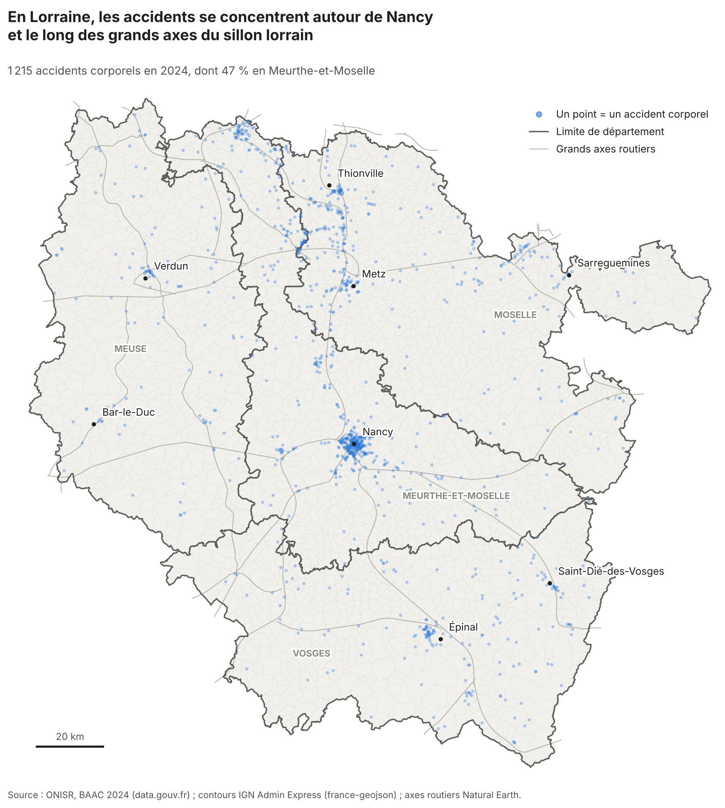
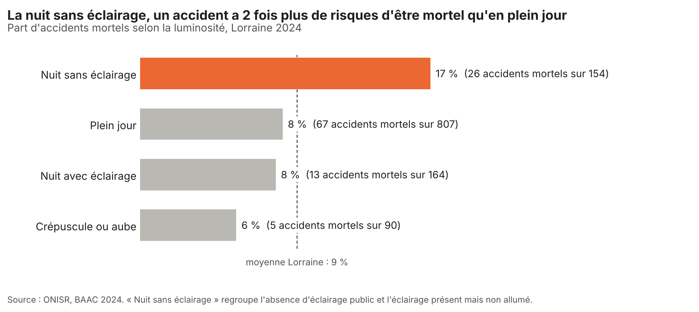

# Accidents de la route en Lorraine (2024)

Source : base BAAC 2024 de l'ONISR ([data.gouv.fr](https://www.data.gouv.fr/datasets/bases-de-donnees-annuelles-des-accidents-corporels-de-la-circulation-routiere-annees-de-2005-a-2025)), pour la Meurthe-et-Moselle, la Meuse, la Moselle et les Vosges. Script : `scripts/analyse_accidents_lorraine.py`.

## Lecture des résultats

En 2024, la police et la gendarmerie ont enregistré 1 215 accidents avec victimes en Lorraine. 111 d'entre eux ont fait au moins un mort, pour 118 personnes tuées au total.

**La carte** montre un territoire très inégal. Les points se resserrent autour de l'agglomération de Nancy. Ils dessinent aussi une ligne nord-sud qui passe par Metz et Thionville jusqu'à la frontière luxembourgeoise. La Meuse et l'ouest des Vosges, peu peuplés, restent presque vides.

Le nombre d'accidents ne dit pourtant rien de leur gravité. La Meurthe-et-Moselle concentre près de la moitié des accidents (47 %), mais seulement un accident mortel sur cinq. Un accident sur vingt-cinq y est mortel (4 %). Ailleurs, la proportion est bien plus forte : 13 % en Moselle, 15 % dans les Vosges et 16 % en Meuse, soit environ un sur six. Hors agglomération, 15 % des accidents sont mortels, près de trois fois plus qu'en ville (5 %). Les routes départementales réunissent à elles seules 61 % des accidents mortels.

**Le graphique sur la luminosité** va dans le même sens. Les accidents de nuit sur une route non éclairée ne sont pas les plus nombreux (13 % du total). Mais 17 % d'entre eux sont mortels, soit le double du plein jour ou de la nuit sur une voie éclairée (8 %). On fait le même constat au niveau national. Il faut toutefois le nuancer : près de 8 de ces accidents sur 10 ont lieu hors agglomération, où l'on roule plus vite. L'éclairage n'explique donc pas tout.

Deux réserves s'imposent. Une seule année et 111 accidents mortels ne suffisent pas pour avoir des taux solides. De plus, sans données sur le trafic, ces chiffres décrivent la gravité des accidents, pas le risque d'en avoir un.

## Justification des choix graphiques

| Choix | Raison | Règle |
|---|---|---|
| Points petits et transparents | Avec plus de 1 200 accidents, la superposition fait ressortir les zones denses sans cacher les communes | 13 |
| Une seule couleur pour les accidents sur la carte | Il n'y a rien à distinguer par la couleur, et la carte reste lisible pour les daltoniens | 8 |
| Villes et départements nommés sur la carte | On se repère sans aller chercher une légende | 9 |
| Quatre catégories de luminosité au lieu de cinq | « Éclairage présent mais non allumé » ne concerne que 16 accidents : je l'ai fusionné avec « sans éclairage » | 11 |
| Barres horizontales classées du taux le plus fort au plus faible | Les libellés longs restent lisibles et le classement se voit tout de suite | 7 et 12 |
| Taux et effectif écrits au bout de chaque barre, sans axe | On lit la valeur directement et on voit sur combien d'accidents repose chaque taux | 9 |
| Pourcentages arrondis à l'unité | Avec des effectifs de quelques dizaines, une décimale donnerait une fausse précision | 14 |
| Orange pour « nuit sans éclairage », gris pour les autres catégories | Une seule couleur d'accent attire l'œil sur le message | 8 |
| Titres qui donnent la conclusion, sans cadre, ombre ni grille | Le message se lit en premier et rien ne le parasite | 10 et 16 |
