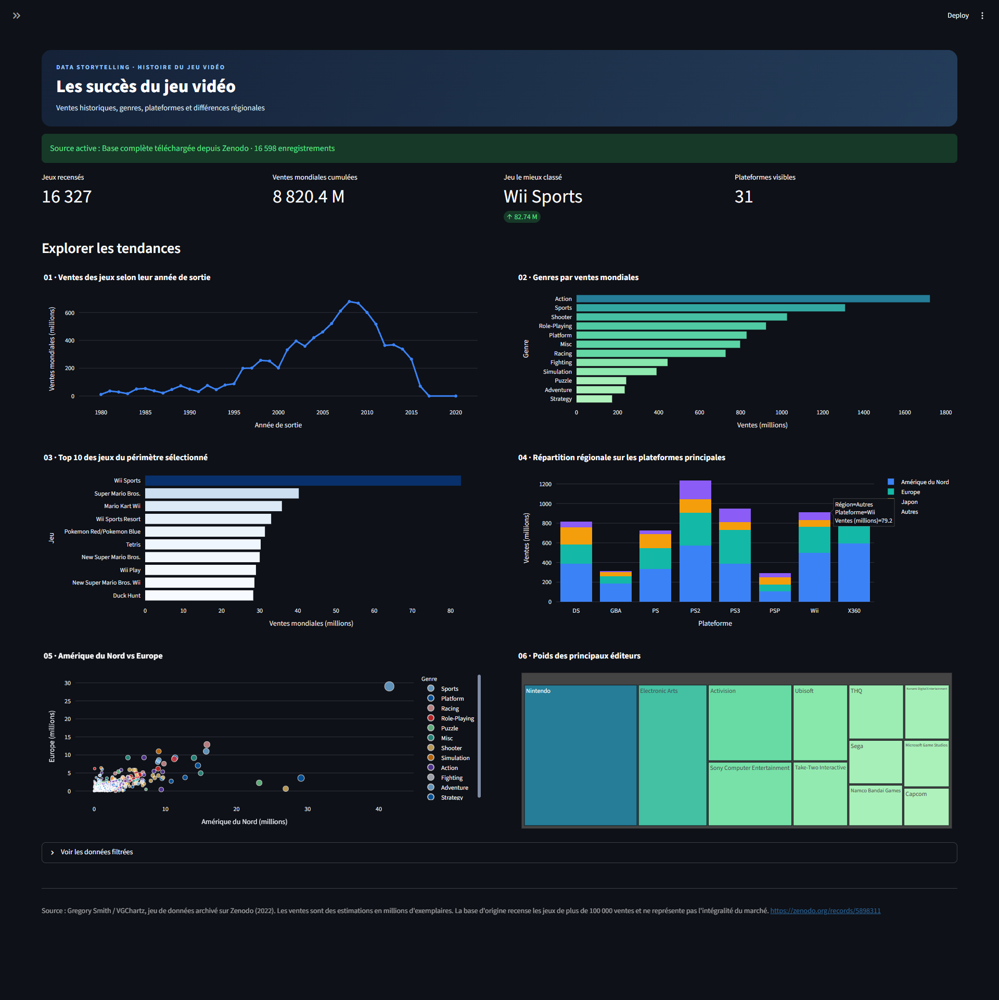

# Les succès du jeu vidéo

Ce projet présente un tableau de bord consacré à l'évolution des ventes de jeux vidéo. Il permet de comparer les genres et les plateformes, d'observer les différences entre régions et d'identifier les jeux et éditeurs les plus performants.

## Données utilisées

Le jeu de données **Video Game Sales**, archivé sur [Zenodo](https://zenodo.org/records/5898311), rassemble 16 598 enregistrements de jeux vidéo. Il contient notamment l'année de sortie, la plateforme, le genre, l'éditeur et des estimations de ventes en Amérique du Nord, en Europe, au Japon, dans les autres régions et dans le monde. Les ventes sont exprimées en millions d'exemplaires.

La base provient de données de VGChartz et ne couvre pas l'ensemble du marché : selon cette source, elle recense les jeux ayant dépassé 100 000 ventes.

## Capture du dashboard

